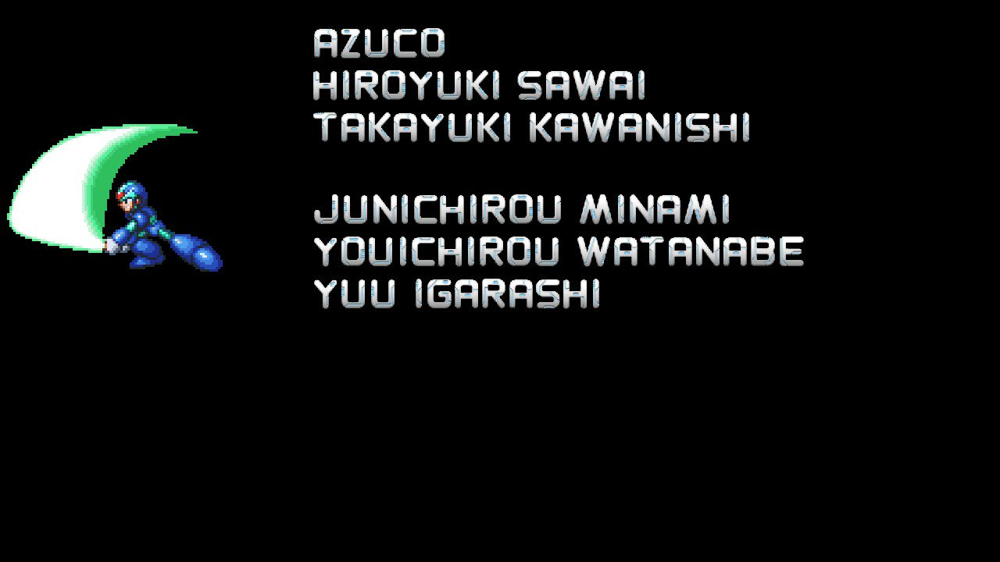

# AZUCOについて
リアルタイム寄りマルチスレッド、ハードウェア寄りのプログラム、ゲームや暗号の解析やってます  
深夜アニメをひたすら見続ける、14歳の土木作業員（プロのプログラマではない）  

## Projects
### Emulator development
| Name | Target | Description |
| --- | --- | --- |
| A-SATURN G3 | SEGA Saturn | プライベートリポジトリで基本的にバイナリ非公開 |
| AX68K | X68000 | MC680x0コアを開発するのが目的 |
| A-NeXT | NeXT CUBE | MC680x0コアを開発するのが目的 |
| Hornet | KONAMI Hornet PCB | PowerPCコアを開発するのが目的 |
| APS1 | Sony Playstation 1 | R3000コアを開発するのが目的、PS1が一番好き |

### Game data converter
主にPS2の頃のゲームのデータを、PCで扱えるようにするためのコンバータ  
解析の修行として行ったので、現在は基本的にコンバータは作っていない  

### Tools
| Name | Description |
| --- | --- |
| AZUCO ZIP file Splitter | 破損したZIPファイルから、個別のデータを可能な限り救出するためのツール |
| ASPT | Windows記憶域プールの問題をきっかけに作成した調査用ツール |

### Works
switch ロックマンX アニバーサリー コレクション 1　　

### Related Sites
- [Personal Website](https://azuco.sakura.ne.jp/)
- [twitter](https://x.com/azuco_twt/)
- [e-mail](mailto:azuco@azuco.sakura.ne.jp)
